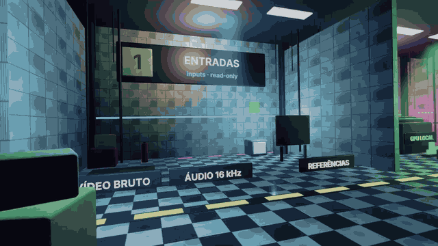
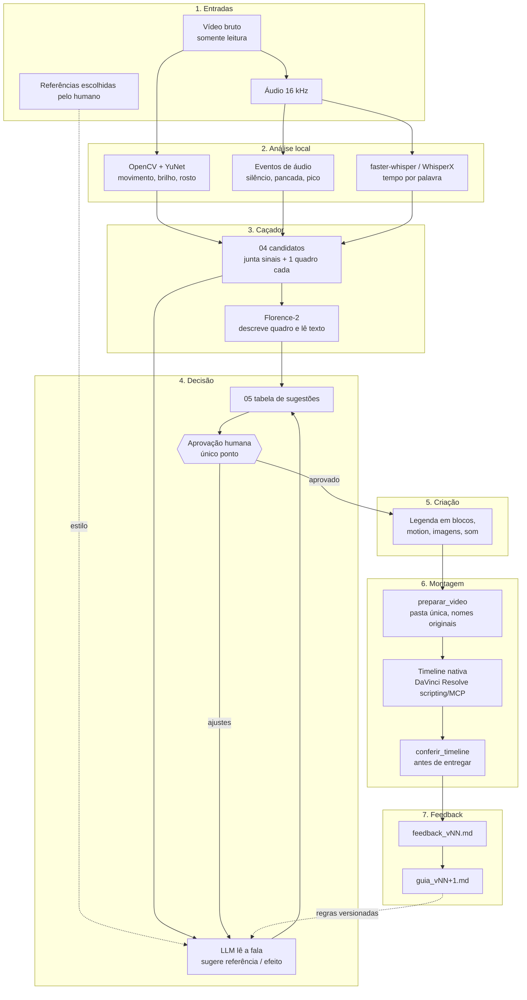

# pipeline-video-ia-local

🇧🇷 [Português](#português) · 🇬🇧 [English](#english)



---

## Português

### O problema
Editar vídeos longos e gravações ao vivo levava **horas**: assistir tudo, anotar momentos, decidir onde entra efeito, som ou corte. Fazer isso com um LLM "olhando tudo" custa caro e não escala.

### A solução
Um **funil local e gratuito** que roda na própria máquina (GPU de consumo, RTX 3060) e reduz o vídeo a poucas dezenas de **candidatos**. Os scripts só **marcam**; uma IA lê a fala e sugere; **um único ponto de aprovação humana** (a tabela de sugestões) decide o que vira edição. Nada é montado antes disso e nada toca o material bruto.

Regras do método: custo zero · local primeiro · script nunca altera bruto nem biblioteca · nunca sobrescrever (versões `v01`, `v02`) · saída curta no terminal · a IA executa, o humano decide o gosto.

### Camadas



### Ferramentas e onde cada uma entra

| Ferramenta | Onde entra | Roda em |
|---|---|---|
| faster-whisper / WhisperX | transcrição e **tempo por palavra** (`03_alinhar_whisperx.py`, `legenda_blocos.py`) | GPU |
| OpenCV + YuNet | movimento, brilho, tamanho de rosto (`01_opencv_marcar.py`); análise de referências (`estilo/`) | CPU |
| Florence-2 | descrição de quadros e OCR (`florence_quadros.py`) | GPU |
| yt-dlp | baixar referências que o humano escolheu (`baixar_refs.py`) | CPU |
| DaVinci Resolve scripting / MCP | timeline nativa em lote e conferência (`conferir_timeline.py --vivo`) | local |
| Python | cola de tudo: scripts, validação, versionamento de saídas | CPU |
| GPU RTX 3060 (8 GB) | um trabalho de GPU por vez | — |

**Números do método (na pasta de trabalho original):** a documentação foi enxugada de **1049 arquivos para 297** (versões antigas e guias redundantes foram juntados ou arquivados) e restaram **16 scripts vivos** (os demais ficaram parados ou foram aposentados). Este repositório publica a parte genérica desses scripts.

### Estrutura

```
cacador/     01_opencv_marcar → 02_audio_eventos → 03_alinhar_whisperx → 04_candidatos → 05_tabela (+ florence_quadros)
montagem/    preparar_video, conferir_timeline, legenda_blocos
estilo/      analisa_ref, quadros_chave, baixar_refs, comparar_criadores
feedback/    feedback_pendente, mapa_dos_guias, modelo_feedback.md
docs/        nucleo, mapa-do-que-temos, como-os-guias-se-atualizam, descobrir-estilo, venvs
exemplos/    clipe sintético + saídas reais (CSV/JSON/tabela) + GIF do fluxo
tests/       pytest (sem GPU, sem download de modelos)
```

### Rodar o exemplo (CPU)
```bash
python -m venv .venv && source .venv/bin/activate
pip install -r requirements-dev.txt && cp .env.example .env
python exemplos/gerar_exemplo.py exemplos                    # (re)gera o clipe sintético
python cacador/01_opencv_marcar.py exemplos/clip_sintetico.mp4 saida/opencv_v01.csv
python cacador/02_audio_eventos.py exemplos/clip_16k_mono.wav saida/audio_eventos_v01.csv
cp exemplos/saidas/palavras_v01.json saida/               # passo 3 exige GPU; veja a nota abaixo
python cacador/04_candidatos.py exemplos/clip_sintetico.mp4 saida
```
Passos 3 e Florence-2 precisam de GPU e modelos baixados (veja [docs/venvs.md](docs/venvs.md)).

**O que é real e o que é ilustrativo nos exemplos:** o clipe é **sintético** (gerado por código, sem direitos de terceiros). `opencv_v01.csv`, `audio_eventos_v01.csv`, `candidatos_v01.csv`, `tabela_cacador_v01.md`, `legenda_blocos_v01.*`, `conferir_timeline_saida.txt`, `materiais_*` e `estilo_clip_a/` são **saídas reais** dos scripts. `palavras_v01.json` (passo 3) e `florence_v01.json` foram **escritos à mão** para ilustrar o formato e estão marcados como tal. As marcações `risada?` no exemplo são falsos positivos conhecidos da heurística de áudio.

### Maturidade
- `requirements.txt` (CPU), `requirements-gpu.txt`, `requirements-dev.txt` e ambientes documentados em [docs/venvs.md](docs/venvs.md).
- Configuração por `.env` (`.env.example`); nada de caminhos fixos.
- GitHub Actions: `ruff check`, `ruff format --check` e `pytest` a cada push (`.github/workflows/lint.yml`).
- `pytest`: testes de versionamento de saídas, blocos de legenda, regras da timeline, relatório de materiais e o funil inteiro no clipe sintético.
- Não coberto por testes automáticos: `conferir_timeline.py --vivo` (precisa do DaVinci aberto) e os passos de GPU.

### Limites honestos
O funil acha o que se **vê e ouve**, não a graça. `risada?` é um palpite; WhisperX só alinha o texto que já existe; Florence-2 descreve em inglês e não reconhece referências culturais. Por isso a tabela é sugestão e a decisão é humana.

---

## English

### The problem
Editing long videos and live recordings took **hours**: watching everything, noting moments, deciding where effects, sound or cuts go. Having an LLM "watch everything" is expensive and does not scale.

### The solution
A **local, free funnel** running on the user's own machine (consumer GPU, RTX 3060) that reduces a video to a few dozen **candidates**. Scripts only **mark**; an AI reads the speech and suggests; **a single human approval point** (the suggestion table) decides what becomes an edit. Nothing is assembled before that and nothing touches the raw footage.

Method rules: zero cost · local first · scripts never alter raw footage or the library · never overwrite (versions `v01`, `v02`) · short terminal output · the AI executes, the human decides taste.

### Layers
The diagram above (Inputs → Local analysis → Hunter → Decision → Creation → Assembly → Feedback) is the same in both languages; labels are in Portuguese.

### Tools and where each one fits

| Tool | Where it fits | Runs on |
|---|---|---|
| faster-whisper / WhisperX | transcription and **per-word timing** | GPU |
| OpenCV + YuNet | motion, brightness, face size; reference analysis | CPU |
| Florence-2 | frame description and OCR | GPU |
| yt-dlp | download references the human picked | CPU |
| DaVinci Resolve scripting / MCP | native timeline in batch and checks | local |
| Python | glue: scripts, validation, output versioning | CPU |
| RTX 3060 (8 GB) GPU | one GPU job at a time | — |

**Numbers (original working folder):** documentation went from **1049 files down to 297**, leaving **16 live scripts**. This repo publishes the generic part of them.

### Structure, example and maturity
See the Portuguese section above: the tree, the run-the-example commands and the maturity list apply as written. Key points: `requirements*.txt` + documented venvs, `.env.example`, GitHub Actions (`ruff` + `pytest`), a **synthetic** example clip (no third-party media) with real script outputs, and a workflow GIF. `palavras_v01.json` and `florence_v01.json` are hand-written illustrations because those steps need a GPU and downloaded models.

### Honest limits
The funnel finds what can be **seen and heard**, not what is funny. `risada?` ("laughter?") is a guess; WhisperX only aligns existing text; Florence-2 describes in English and does not recognise cultural references. That is why the table is a suggestion and the decision is human.

### Docs
[nucleo](docs/nucleo.md) · [mapa-do-que-temos](docs/mapa-do-que-temos.md) · [como-os-guias-se-atualizam](docs/como-os-guias-se-atualizam.md) · [descobrir-estilo](docs/descobrir-estilo.md) · [venvs](docs/venvs.md)

License: MIT.
