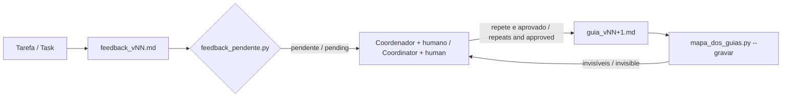

# Como os guias se atualizam / How guides get updated

**PT.** Guias não são editados no lugar. O ciclo é:

1. Cada tarefa termina com um arquivo de **feedback** (`feedback/feedback_<tarefa>_<data>_vNN.md`), criado pelo modelo `feedback/modelo_feedback.md`: o que o humano disse, ajustes, descobertas (inclusive o que falhou), resultado e a seção **"Guia que pode precisar de ajuste"**.
2. `feedback/feedback_pendente.py` junta essa seção de todos os feedbacks e mostra, para cada guia citado, se já existe versão mais nova que o feedback.
3. Uma sessão coordenadora (ou o humano) analisa. Correção só vira **regra** se se repetir em vários vídeos *e* o humano aprovar. Dois registros contraditórios: mostram-se os dois e pergunta-se.
4. A atualização cria `guia_vNN+1.md`; a versão antiga sai de circulação (pasta `antigas/` ou de lixo, que o humano esvazia).
5. `feedback/mapa_dos_guias.py --gravar` regenera o mapa e avisa dos **documentos invisíveis**: guias que nenhum documento de leitura cita e que, por isso, nenhuma sessão abriria.

**EN.** Guides are never edited in place:

1. Every task ends with a **feedback** file built from the template: what the human said, adjustments, discoveries (including failures), result, and the section **"Guide that may need changes"**.
2. `feedback_pendente.py` collects that section from every feedback file and checks whether a newer guide version exists.
3. A coordinator (or the human) reviews. A correction becomes a **rule** only if it repeats across several videos *and* the human approves. Contradictory records are shown side by side.
4. The update creates `guide_vNN+1.md`; the old one leaves circulation.
5. `mapa_dos_guias.py --gravar` regenerates the map and flags **invisible documents**.

